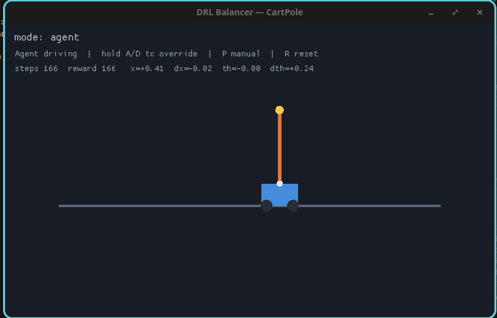

# DRL Balancer

Small learning/demo repo: **deep reinforcement learning** in Rust with [Burn](https://burn.dev/). An agent learns to balance the classic **CartPole**; the live demo uses [macroquad](https://github.com/not-fl3/macroquad).



## Stack

| Component | Technology |
|-----------|------------|
| Language | Rust (edition 2024) |
| Env | Custom CartPole sim (Gym params: τ=0.02, ±10 N, fail if \|x\|>2.4 or \|θ\|>12°) |
| ML | [Burn](https://burn.dev/) 0.21 — `ndarray` + `autodiff` backends |
| Policy | MLP `4 → 64 → 2` (REINFORCE) |
| Demo / render | [macroquad](https://github.com/not-fl3/macroquad) 0.4 |
| Lint | `warnings = deny`, `clippy::all = deny` |

Binaries:

| Command | Binary | Role |
|---------|--------|------|
| `cargo run` | `drl-balancer` (default) | macroquad demo |
| `cargo run --release --bin train` | `train` | headless training |

## Requirements

- Rust toolchain (edition 2024 / recent stable)
- Display for the demo window
- Training runs headless on CPU (`ndarray`)

## Run: demo

Without weights, train first (writes `artifacts/policy.mpk`):

```bash
cargo run --release --bin train
```

Then start the demo:

```bash
cargo run
# equivalent: cargo run --bin drl-balancer
```

If `artifacts/policy.mpk` exists, the demo starts in **agent mode** (greedy argmax). Otherwise it stays manual (console hint: train as above).

| Key | Action |
|-----|--------|
| **P** | Toggle agent ↔ manual (only if a policy is loaded) |
| **A/D** or arrow keys | Push; override while in agent mode |
| **R** | Reset episode |
| **Space** | Reset after failure |

In agent mode: auto-reset ~1 s after failure, or after 500 steps (Gym cap).

## Run: training

```bash
cargo run --release --bin train
```

- Algorithm: **REINFORCE** (Adam, return normalization, grad clip)
- Early stop when moving-average reward ≥ **475** (else max 400 episodes)
- Writes weights to **`artifacts/policy.mpk`** (`artifacts/` is gitignored)

Typical (release, CPU): solved within a few minutes.

## Tests

```bash
cargo test
cargo clippy --all-targets
```

## Layout

```
src/
  cartpole.rs   # physics / step(action)
  policy.rs     # Burn PolicyNet
  train.rs      # REINFORCE loop
  agent.rs      # inference: load policy.mpk
  demo.rs       # demo loop
  viz.rs        # macroquad drawing
  bin/train.rs  # training entry
  main.rs       # demo entry
assets/         # README screenshots
docs/status/    # Kanban (status.md / done.md)
```

## Project status

Kanban: [docs/status/status.md](docs/status/status.md)

Demo pipeline complete: env → train → live eval.

## License

[MIT](LICENSE)
